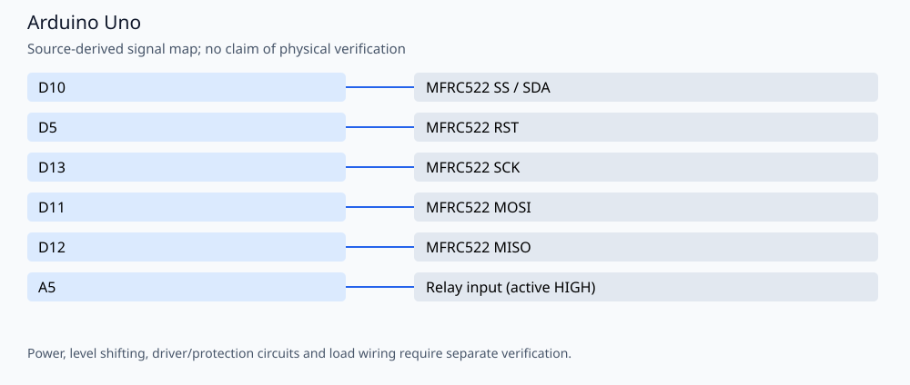

# RFID cabinet door controller

An MFRC522 cabinet-access prototype with two stored seven-byte UIDs, a 100 ms active-HIGH relay pulse and a three-second serial heartbeat. Author: **Amirmobasheraghdam**.

## Reproducible build

Install Python 3 and **Arduino CLI 1.3.1**, then run from this repository:

```bash
python3 tools/check_firmware.py --install
```

The helper installs `arduino:avr@1.8.6` and `MFRC522@1.4.12`, `TimerOne@1.1.1`. It compiles these alternatives
separately in temporary folders, without uploading or rewriting the originals:

- `rfid-cabinet-door.ino`

Build target: `arduino:avr:uno`. Once dependencies are installed, omit `--install`
to build offline. `--jobs 2` is the default. Set `ARDUINO_CLI` to a CLI executable
or wrapper when using a custom Arduino configuration. Exact build inputs are in
[`tools/firmware.json`](tools/firmware.json). Library dependencies are listed
explicitly and installed with `--no-deps` so transitive updates cannot silently
replace the pinned versions. These are tested build versions, not a claim that
all other core/library versions are incompatible.

The GitHub Actions workflow repeats the firmware checks on pushes and pull
requests. Compilation validates software/toolchain compatibility; it does not
establish hardware safety or successful physical operation.

## Signal assignments



| Signal | Board pin |
| --- | --- |
| MFRC522 SS / SDA | D10 |
| MFRC522 RST | D5 |
| MFRC522 SCK | D13 |
| MFRC522 MOSI | D11 |
| MFRC522 MISO | D12 |
| Relay input (active HIGH) | A5 |

## Operation and validation limits

The pin map is for an Uno: a Mega uses different hardware-SPI pins. Verify 3.3 V RC522 power, appropriate logic-level adaptation and the relay module interface. A5 is used as a relay output, so it is not available for an I2C SCL connection in this sketch. Use a properly rated external lock supply; no load power circuit is specified here. Serial messages use **9600 baud**.

The UID comparison now requires an exact seven-byte match. Previously a matching four-byte prefix could be accepted, and a longer card could read beyond the stored UID. Tests cover matching, prefix, longer, different, empty and null inputs with memory sanitizers. **This changes authentication decisions and must receive security/hardware validation before merging or deployment.** UID-only authorization is not cryptographic access control. Relay timing and stored UID values are unchanged.

```bash
g++ -std=c++11 -Wall -Wextra -Werror -fsanitize=address,undefined \
  -fno-omit-frame-pointer tests/test_uid.cpp -o /tmp/uid-tests
/tmp/uid-tests
```

No physical testing, new hardware photographs or measured electrical/optical
performance is claimed. Retain the author attribution and existing license/source
notices when reusing the project.
